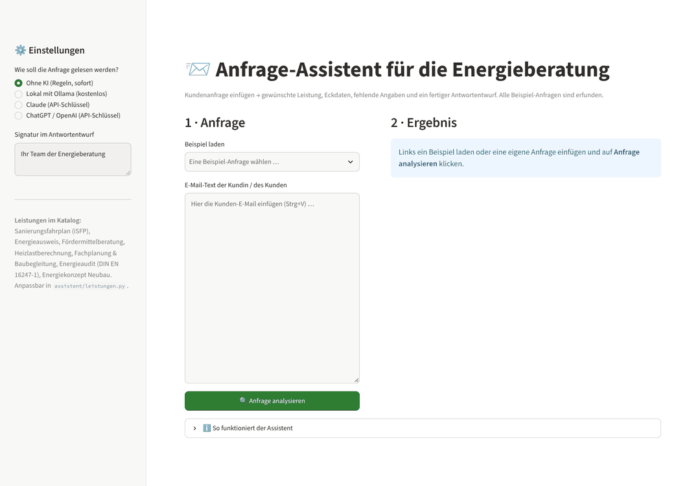
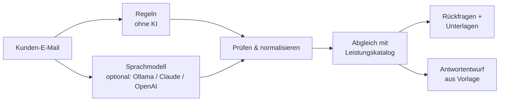

# 📨 Anfrage-Assistent für die Energieberatung

**Kunden-E-Mail rein → gewünschte Leistung, Eckdaten, Rückfragen und ein fertiger Antwortentwurf raus.**

In einem Energieberatungsbüro kommen viele Anfragen per E-Mail: „Wir brauchen einen Energieausweis“, „Können Sie einen Sanierungsfahrplan erstellen?“, „Gibt es Förderung für unsere Wärmepumpe?“. Fast immer fehlen Angaben, die man für ein Angebot braucht, zum Beispiel Baujahr, Wohnfläche oder Heizung. Diese Rückfragen schreibt man jedes Mal neu von Hand.

Dieser Prototyp nimmt dem Büro diese Routine ab:

- **erkennt die gewünschte Leistung**: iSFP, Energieausweis, Fördermittelberatung, Heizlastberechnung, Fachplanung & Baubegleitung, Energieaudit, Energiekonzept Neubau
- **liest die Eckdaten heraus**: Gebäudetyp, Baujahr, Wohnfläche, Heizung, Standort, geplante Maßnahmen, Zeitplan, Kontaktdaten
- **erkennt Unterschiede**: die *aktuelle* Ölheizung im Gegensatz zur *geplanten* Wärmepumpe, oder Fenster, die *schon getauscht wurden*, im Gegensatz zu solchen, die erst *getauscht werden sollen*
- **findet fehlende Angaben** und macht daraus höfliche Rückfragen und eine Unterlagen-Checkliste
- **schreibt einen Antwortentwurf**, den man bearbeiten und mit einem Klick im E-Mail-Programm öffnen kann
- **markiert Eilfälle** (z. B. Notartermin) und gibt interne Hinweise (z. B. „Aufträge schon vergeben – Förderfähigkeit prüfen“)



> Alle Beispiel-Anfragen im Ordner `beispiele/` sind erfunden. Es werden keine echten Kundendaten verwendet.

---

## So testen Sie es (ca. 2 Minuten)

### 1. Starten

Voraussetzung: **Python 3.10 oder neuer** ([python.org](https://www.python.org/downloads/)). Unter Windows bei der Installation „Add Python to PATH“ anhaken.

| System | Start |
|---|---|
| **macOS** | `start_mac.command` doppelklicken (beim ersten Mal: Rechtsklick → *Öffnen*) – oder im Terminal: `bash start_mac.command` |
| **Windows** | `start_windows.bat` doppelklicken |

Beim ersten Start wird alles automatisch eingerichtet (1–2 Minuten). Danach öffnet sich der Assistent im Browser unter **http://localhost:8501**.

<details>
<summary>Manuell im Terminal starten</summary>

```bash
python3 -m venv .venv
source .venv/bin/activate          # Windows: .venv\Scripts\activate
pip install -r requirements.txt
streamlit run app.py
```
</details>

### 2. Ausprobieren

1. Links unter **„Beispiel laden“** eine Anfrage wählen – oder eine eigene E-Mail einfügen.
2. Auf **„Anfrage analysieren“** klicken.
3. Rechts die Reiter **Eckdaten**, **Rückfragen & Unterlagen** und **Antwortentwurf** ansehen.

Ohne weitere Einrichtung läuft der Assistent im Modus **„Ohne KI (Regeln)“**. Das geht sofort, kostet nichts und funktioniert offline.

### 3. Optional: mit lokaler KI (kostenlos und datenschutzfreundlich)

Mit einem Sprachmodell versteht der Assistent auch frei formulierte Anfragen deutlich besser. Mit **Ollama** läuft das Modell direkt auf dem eigenen Rechner. **Kundendaten verlassen den Rechner nicht.**

1. Ollama installieren: [ollama.com/download](https://ollama.com/download)
2. Ein Modell laden (einmalig, ca. 2 GB):
   ```bash
   ollama pull llama3.2
   ```
3. Den Assistenten neu laden. In der Seitenleiste ist dann **„Lokal mit Ollama“** automatisch ausgewählt.

Größere Modelle (z. B. mit 7–8 Mrd. Parametern) erkennen freie Texte noch zuverlässiger, brauchen aber mehr Arbeitsspeicher. Sie lassen sich in der Seitenleiste auswählen.

### 4. Optional: mit Claude oder ChatGPT

In der Seitenleiste **„Claude“** oder **„ChatGPT / OpenAI“** wählen und einen eigenen API-Schlüssel eingeben. Der Schlüssel wird nicht gespeichert. In diesem Modus wird die Anfrage zur Analyse an den jeweiligen Anbieter gesendet.

---

## Wie es funktioniert



1. **Regeln** (reguläre Ausdrücke) erkennen typische Angaben sofort, auch ganz ohne KI.
2. **Optional liest ein Sprachmodell** die Anfrage und liefert die Angaben als JSON. KI-Werte haben Vorrang, Lücken füllen die Regeln. Fällt die KI aus, läuft alles mit den Regeln weiter.
3. **Jeder Wert wird geprüft**: Gebäudetyp und Heizung werden auf feste Kategorien abgebildet, das Baujahr muss plausibel sein usw. So kann die KI keine Fantasiewerte einschleusen.
4. **Leistungskatalog** (`assistent/leistungen.py`): Für jede Leistung ist hinterlegt, welche Angaben und Unterlagen das Büro braucht. Was fehlt, wird zur Rückfrage.
5. **Antwortentwurf aus einer Vorlage**: Er enthält nur Angaben aus der Anfrage, keine erfundenen Preise, Termine oder Zusagen. Optional kann die KI den Text sprachlich glätten. Fehlen danach Fragen oder tauchen Preise auf, wird automatisch der Originalentwurf verwendet.
6. **Nichts wird automatisch verschickt.** Ein Mensch prüft den Entwurf immer zuerst.

## Anpassen

Leistungen, Rückfragen und Unterlagen stehen gut lesbar in **`assistent/leistungen.py`** und lassen sich ohne Programmierkenntnisse ändern. Die Signatur der Antwort kann in der Seitenleiste angepasst werden.

## Projektstruktur

```
app.py                  Oberfläche (Streamlit)
assistent/
  regeln.py             Erkennung ohne KI
  llm.py                Anbindung Ollama / Claude / OpenAI
  schema.py             Datenmodell + Prüfung der Werte
  leistungen.py         Leistungskatalog (anpassbar)
  antwort.py            Rückfragen, Unterlagen, Antwortentwurf
  pipeline.py           Gesamtablauf
beispiele/              erfundene Beispiel-Anfragen
tests/                  automatische Tests (pytest)
```

## Tests

```bash
pip install -r requirements-dev.txt
pytest
```

Die Tests prüfen die Erkennung an allen Beispielen, die Prüfung von KI-Ausgaben, den Rückfall auf Regeln bei KI-Ausfall, die Schutzregeln beim Glätten, die HTTP-Anbindung an Ollama (gegen einen Test-Server) und die Oberfläche.

## Ideen für den Ausbau

- Anfragen direkt aus dem Postfach lesen (IMAP/Outlook) und als Entwurf ablegen
- Übergabe der Daten an eine Kundenliste oder ein CRM
- **Begehungs-Assistent**: Sprachnotizen und Fotos von der Vor-Ort-Begehung lokal transkribieren (Whisper) und als strukturiertes Protokoll ausgeben

---

Entwickelt von **Arif Onur Alp**, Informatik-Student (B.Sc.) an der RWTH Aachen · [github.com/Cyberboy22](https://github.com/Cyberboy22)
